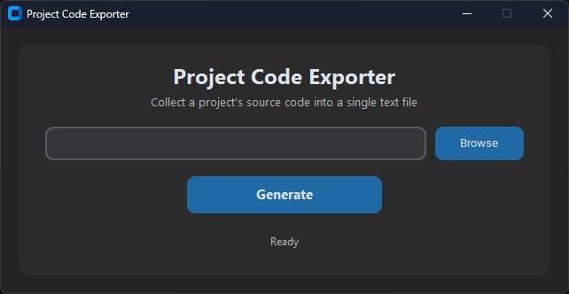
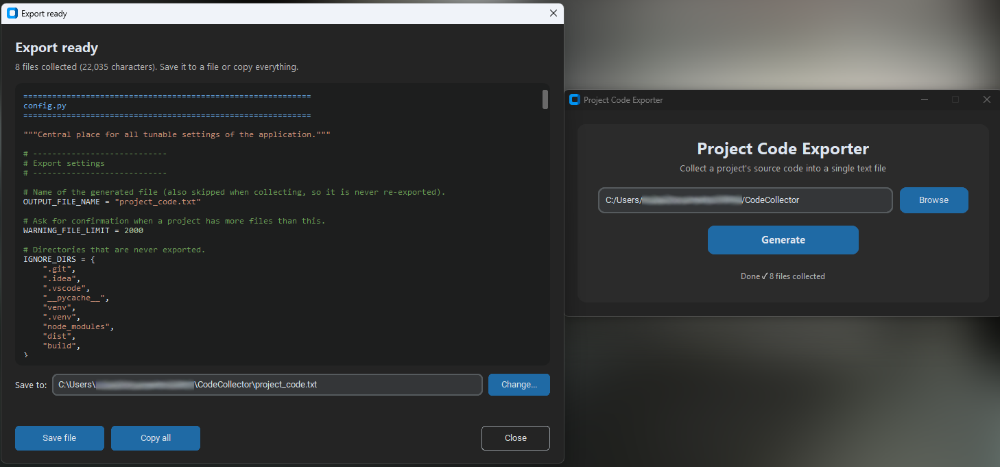
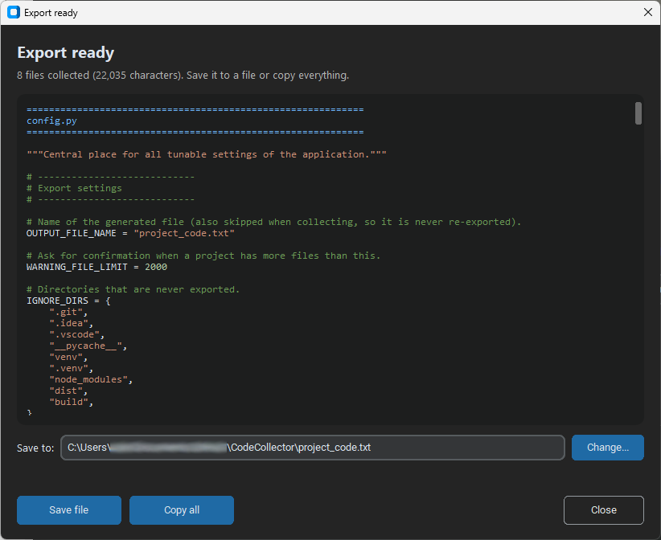

<h1 align="center">CodeCollector</h1>

<p align="center">
  A simple desktop app that collects a project's source code into a single text file - ready to paste into an AI chat or share.
</p>

<p align="center">
  
  
  
</p>

---

## About the project

CodeCollector walks through a project folder, picks up the source files worth sharing and joins them into one text file. Every file is preceded by a header with its relative path, so the result stays easy to read and navigate. After the export, the app shows a colorized preview where you can save the file to a location of your choice or copy everything to the clipboard.

## Features

**Collecting code**
- Recursively collects source files from the selected project folder
- Skips directories such as `.git`, `.idea`, `.vscode`, `__pycache__`, `venv`, `node_modules`, `dist` and `build`
- Supports many languages (Python, JavaScript/TypeScript, C#, Java, Kotlin, C/C++, Go, Rust, PHP, Swift, Dart, SQL, HTML/CSS and common config formats)
- Reads files in several encodings (UTF-8, UTF-8 with BOM, CP1250, Latin-1)
- Asks for confirmation before processing very large projects

**Result window**
- Syntax-highlighted preview, adapted to the light and dark theme
- Save location shown up front (defaults to the project folder) and changeable with a "Save as" dialog
- **Save file** writes the full text to the chosen path
- **Copy all** copies the full, uncolored text to the clipboard

**Interface**
- Clean, minimal window built with CustomTkinter
- Follows the system light/dark mode
- Progress indicator while the project is being scanned

## Screenshots

### Main window

<p align="center">
  
</p>

### After generating

Once the export is finished, the result window opens next to the main window.

<p align="center">
  
</p>

### Result window

A syntax-highlighted preview, the save location (changeable with **Change...**) and the **Save file** / **Copy all** buttons.

<p align="center">
  
</p>

### Example output

Want to see what the program produces? [`project_code.txt`](project_code.txt) is the real export of this very repository - one text file with a header (the relative path) above every source file.

## Architecture

The code is split into small modules with a single responsibility each:

```
CodeCollector/
├── main.py            # Entry point
├── gui.py             # Main window: folder selection and Generate button
├── result_window.py   # Result window: preview, save location, Save / Copy all
├── highlight.py       # Syntax highlighting of the preview (Pygments)
├── exporter.py        # Collecting, reading and joining files, saving the result
├── config.py          # Ignored folders, file extensions, limits, fonts
└── requirements.txt   # Python dependencies
```

### Configuration

All tunable settings live in `config.py`:

- **`IGNORE_DIRS` / `IGNORE_FILES`**: folders and files that are never exported
- **`INCLUDE_EXTENSIONS`**: file extensions that are exported
- **`WARNING_FILE_LIMIT`**: number of files above which the app asks for confirmation
- **`PREVIEW_LIMIT`**: maximum number of characters shown in the preview (saving and copying always use the full text)
- **`OUTPUT_FILE_NAME`**: default name of the generated file

## Tech stack

| Layer | Technologies |
| --- | --- |
| Language | Python 3 |
| GUI | CustomTkinter (Tkinter) |
| Syntax highlighting | Pygments |

## Getting started

Requires Python 3.10 or newer.

1. Clone the repository:

```bash
git clone https://github.com/Narothe/CodeCollector.git
cd CodeCollector
```

2. Create a virtual environment and install the dependencies:

```bash
python -m venv .venv
.venv\Scripts\activate        # Windows
source .venv/bin/activate     # macOS / Linux
pip install -r requirements.txt
```

3. Run the app:

```bash
python main.py
```

### Usage

1. Click **Browse** and select the project folder.
2. Click **Generate**.
3. In the result window, check the preview and choose what to do:
   - **Save file** - writes `project_code.txt` to the path shown in the *Save to* field (use **Change...** to pick another location),
   - **Copy all** - copies everything to the clipboard,
   - **Close** - closes the window without saving.

## License

This project is licensed under the MIT License - see the [LICENSE](LICENSE) file for details.

## Author

- [Narothe](https://github.com/Narothe)
